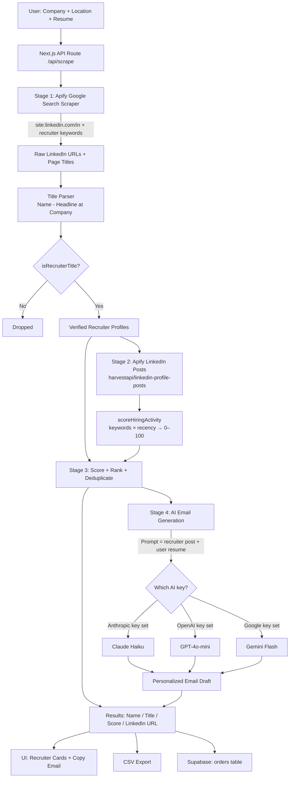

# RecruiterFind

**AI-powered recruiter discovery and cold outreach engine.**

RecruiterFind finds verified recruiting professionals at any company, scores them by real hiring activity from their LinkedIn posts, and generates personalized cold emails using your resume and their actual posts — all without requiring a LinkedIn account.

> Built with Next.js 16, Supabase, Apify, and multi-provider AI (Anthropic → OpenAI → Google Gemini).

---

## The Problem

Finding the right recruiter at a company is tedious:
- LinkedIn search requires a Premium account to see full results
- Generic cold emails get ignored
- You can't tell which recruiters are actively hiring right now

RecruiterFind solves all three — scraping verified recruiter profiles from Google's public LinkedIn index, scoring them by recent hiring posts, and drafting a personalized outreach message based on what *they* posted and *your* background.

---


## Features

- **Verified recruiter profiles** — strict title filtering (`isRecruiterTitle()`) ensures only genuine recruiting professionals appear; no engineers, no false positives
- **Hiring activity scoring** — scrapes each recruiter's recent LinkedIn posts and scores them by recency and hiring signal keywords (0–100 scale)
- **Resume-aware cold emails** — AI reads both the recruiter's post and your pasted resume, picks the single most relevant angle, and drafts a 3-sentence outreach message
- **Multi-provider AI fallback** — Anthropic Claude → OpenAI GPT-4o-mini → Google Gemini, in preference order; uses whichever key you have
- **Location-aware search** — search by city, state, or country (55 options)
- **CSV export** — one-click download of all results with names, titles, LinkedIn URLs, emails (if scraped), hiring scores, and AI-generated email drafts
- **Per-user configuration** — each user stores their own API keys and resume in Supabase; no shared credentials
- **Order history** — every scrape job is recorded with full results for later review

---

## Architecture



---

## Pipeline Detail

| Stage | What it does | Actor / API | Typical time |
|-------|-------------|-------------|-------------|
| **1 — Discovery** | Google search `site:linkedin.com/in` with recruiter keywords + company name. Returns LinkedIn page titles in format `"Name - Headline at Company"`. No LinkedIn auth required. | `apify/google-search-scraper` | ~17s per page |
| **2 — Hiring activity** | Fetches the 3 most recent posts for each confirmed recruiter profile. Scores by keyword match (hiring, open role, join our team…) and recency (100 = last 7 days, 0 = no signal). | `harvestapi/linkedin-profile-posts` | 0–20s |
| **3 — Filter + rank** | Strict `isRecruiterTitle()` check removes false positives. Sort: hiring score ↓, has email ↓. Deduplicate by LinkedIn URL. | — | <1s |
| **4 — AI emails** | Builds a prompt from the recruiter's post + user's pasted resume. AI picks the single most relevant skill/experience and drafts a 3-sentence outreach message. Runs in parallel for top 10 results. | Anthropic / OpenAI / Gemini | ~2–4s |

---

## Tech Stack

| Layer | Choice | Why |
|-------|--------|-----|
| Framework | Next.js 16 (App Router) | Server components, API routes, Turbopack dev speed |
| Auth + DB | Supabase (PostgreSQL + Auth) | Row-level security, per-user config, managed auth flows |
| Scraping | Apify | Managed headless browser infrastructure, no IP bans |
| AI | Anthropic / OpenAI / Gemini | Multi-provider fallback; user brings their own key |
| Deployment | Vercel | Zero-config Next.js, 60s serverless timeout |
| Styling | Inline styles | Avoids Tailwind JIT issues with Turbopack in dev |

---

## Local Setup

### Prerequisites
- Node.js 18+
- An [Apify](https://apify.com) account (free tier works)
- A [Supabase](https://supabase.com) project
- At least one AI API key (Anthropic, OpenAI, or Google AI Studio)

### 1. Clone and install

```bash
git clone https://github.com/your-username/recruiterfind.git
cd recruiterfind
npm install
```

### 2. Create `.env.local`

```bash
cp .env.example .env.local
```

Fill in the values:

```env
# Supabase
NEXT_PUBLIC_SUPABASE_URL=https://your-project.supabase.co
NEXT_PUBLIC_SUPABASE_ANON_KEY=your-anon-key

NEXT_PUBLIC_APP_URL=http://localhost:3000
DEV_BYPASS_AUTH=false
```

> For fast local dev without auth, set `DEV_BYPASS_AUTH=true` and add your API keys directly to `.env.local`. See [Dev bypass mode](#dev-bypass-mode) below.

### 3. Set up the database

In your Supabase project → **SQL Editor** → paste and run [`supabase/schema.sql`](supabase/schema.sql).

This creates:
- `orders` — one row per scrape job, stores full results as JSONB
- `configurations` — per-user API keys, resume, and custom email prompt; row-level security ensures users only see their own row

### 4. Run

```bash
npm run dev
# → http://localhost:3000
```

---

## Environment Variables

| Variable | Required | Description |
|----------|----------|-------------|
| `NEXT_PUBLIC_SUPABASE_URL` | Yes | Supabase project URL |
| `NEXT_PUBLIC_SUPABASE_ANON_KEY` | Yes | Supabase anon/public key |
| `NEXT_PUBLIC_APP_URL` | Yes | Full URL of the app (used for auth redirects) |
| `DEV_BYPASS_AUTH` | Dev only | Set `true` to skip auth and load keys from env |
| `APIFY_API_KEY` | Dev only | Only needed when `DEV_BYPASS_AUTH=true` |
| `GOOGLE_AI_STUDIO_KEY` | Dev only | Only needed when `DEV_BYPASS_AUTH=true` |

In production, Apify and AI keys are stored per-user in the `configurations` table — not in env vars.

---

## Dev Bypass Mode

For local development without Supabase auth:

```env
DEV_BYPASS_AUTH=true
APIFY_API_KEY=apify_api_...
GOOGLE_AI_STUDIO_KEY=...
USER_RESUME=Your name, background, skills...
```

The route skips auth, reads keys from env, and returns results directly without writing to the DB. Flip back to `false` to test the full production auth + DB path.

---

## Project Structure

```
src/
├── app/
│   ├── (marketing)/landing/     # Public landing page
│   ├── (auth)/login/            # Login page
│   ├── (auth)/signup/           # Signup page
│   ├── (app)/scrapper/          # Main scraper UI (protected)
│   ├── (app)/orders/            # Order history (protected)
│   ├── (app)/configuration/     # API keys + resume (protected)
│   └── api/scrape/route.ts      # Core pipeline (Stages 1–4)
├── lib/
│   ├── supabase/                # Server + client Supabase helpers
│   └── utils.ts                 # resultsToCSV(), getHiringScoreLabel()
├── types/index.ts               # RecruiterResult, ScrapeRequest, Order
└── proxy.ts                     # Auth gating middleware
supabase/
└── schema.sql                   # Full DB schema (idempotent)
```

---

## Deployment (Vercel)

1. Push to GitHub
2. Import repo on [vercel.com](https://vercel.com) — auto-detects Next.js
3. Add environment variables in **Settings → Environment Variables**:
   - `NEXT_PUBLIC_SUPABASE_URL`
   - `NEXT_PUBLIC_SUPABASE_ANON_KEY`
   - `NEXT_PUBLIC_APP_URL` → your Vercel domain
   - `DEV_BYPASS_AUTH` → `false`
4. Redeploy
5. In Supabase → **Authentication → URL Configuration**, add your Vercel domain to allowed redirect URLs

---

## Roadmap

- [ ] Email enrichment via Hunter.io / Apollo (currently blank unless scraped)
- [ ] Async job processing to handle larger result sets (100+ recruiters)
- [ ] LinkedIn cookie support for deeper profile data
- [ ] Saved search templates
- [ ] Team/multi-user support

---

## License

MIT
